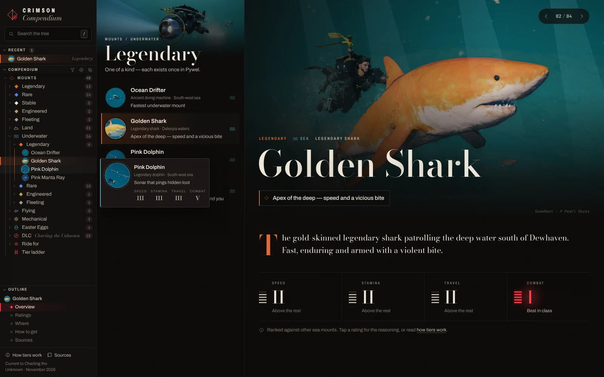
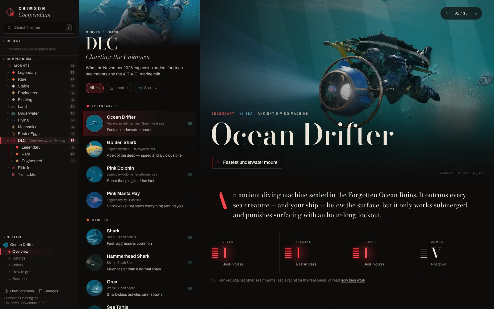
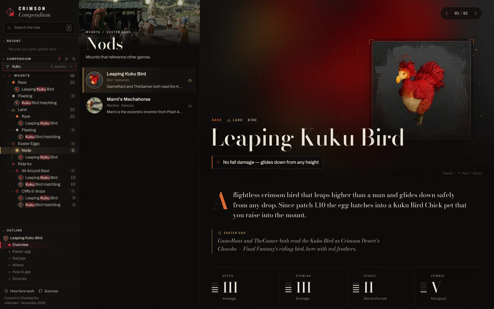
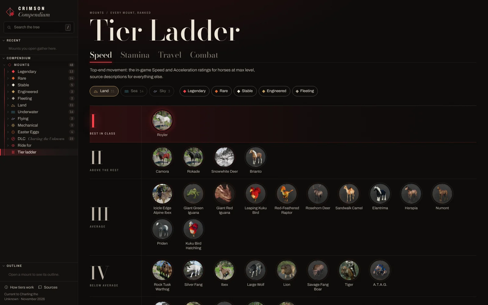

<p align="center">
  
</p>

<h1 align="center">Crimson Compendium</h1>

<p align="center">
  <a href="https://github.com/deadcoast/crimson-compendium/actions/workflows/ci.yml"></a>
  <a href="https://github.com/deadcoast/crimson-compendium/releases/latest"></a>
  
</p>

<p align="center">A field reference for <em>Crimson Desert</em>. Pywel's mounts: where each one lives, how to make it yours, and what it is worth riding for.</p>

---

## What's inside

**Mounts**, the first branch of the tree: 48 mounts, each on its own plate.

- **Where**: the in-game map capture and an on-site capture, full width, with a loupe for map labels and a zoomable lightbox.
- **How**: requirement chips, numbered steps, alternate routes and field notes.
- **Tiers**: Speed, Stamina, Travel and Combat rated **I–V** against mounts of the same terrain. Tap a seal to read why it got that rating.
- **Record**: level 1 and level 5 stats for horses, skills, variants and extra stills.

Lists for every way you play a session:

| | |
|---|---|
| **Rarity** | Legendary · Rare · Stable · Engineered · Fleeting |
| **Category branches** | Land · Underwater · Flying · Mechanical · Easter Eggs · DLC: *Charting the Unknown* |
| **Ride for** | All Around Best · Battle · Cliffs & drops · Cargo |
| **Tier Ladder** | every mount ranked per metric, filterable by terrain and rarity |

A mount can sit in several lists. The A.T.A.G. is Land, Underwater, Mechanical and DLC at once.

## Screenshots

<table>
  <tr>
    <td width="50%"><br><sub>Category branch: DLC, <em>Charting the Unknown</em></sub></td>
    <td width="50%"><br><sub>Explorer filter, with the Easter egg note on the plate</sub></td>
  </tr>
  <tr>
    <td width="50%"><br><sub>Tier Ladder</sub></td>
    <td width="50%"><br><sub>Phone: list, plate, explorer drawer</sub></td>
  </tr>
</table>

## Run it

**From a release.** Download `crimson-compendium-v*.zip` from [Releases](https://github.com/deadcoast/crimson-compendium/releases), unzip it and open `index.html`. It needs no server and no install; any static host serves the same folder.

**From source.** Node 18 or newer.

```sh
npm install
npm run dev      # http://localhost:5173
npm run build    # static site in dist/ — opens from disk or any host/sub-path
npm run check    # svelte-check type pass
npm run media    # fetch + convert images for entries with a new "from" URL (Python 3 + Pillow)
```

## Keyboard

| Anywhere | |
|---|---|
| `/` or `Ctrl/⌘ K` | search mounts, places, traits and branches |
| `J` / `K` or `→` / `←` | next / previous mount in the current list |
| `L` | Tier Ladder and back |
| `Alt \` or `Ctrl ⇧ E` | focus the explorer |

| In the explorer | |
|---|---|
| `↑` `↓` `PgUp` `PgDn` `Home` `End` | move |
| `→` / `←` | expand, or step into the folder · collapse, or step out to the parent |
| `Alt →` / `Alt ←` | expand / collapse a whole subtree |
| `Enter` · `Space` | open · fold |
| letters | jump to the next row starting with what you type |
| `Ctrl/⌘ F` · `Esc` | filter the tree · close the filter, then leave the tree |

The explorer follows the VS Code tree widget and Atom tree-view: focus is separate from selection, parent folders stay pinned at the top as you scroll, the active folder's guide line is drawn in its colour, and each mount row shows a hover card.

## Tiers

| | |
|---|---|
| **I** | Best in class — only the best of the best |
| **II** | Not as good as I, better than everything else |
| **III** | Average |
| **IV** | Below average |
| **V** | Not good |

Traits can lift a rating: no fall damage lifts Travel, a unique attack lifts Combat. Every rating stores the reasoning behind it. The full rules, and every editorial call made while building, are in [DESIGN.md](DESIGN.md).

## Project layout

```
src/
  core/              engine — knows nothing about mounts
    types.ts         TREE → BRANCH → (CATEGORY) → LEAF → ENTRY
    tree.ts          routes (#mounts-underwater-rare), lists, lenses, covers
    select.ts        selectors and tier ranking
    explorer.ts      explorer model: rows, filter, sticky rows, auto-reveal
    state.svelte.ts  route, overlays, recent history
  ui/                shared components (Explorer, LeafIndex, Plate, Ladder, Palette…)
  branches/
    registry.ts      lists the branches and validates them at load
    mounts/
      branch.json    leaves, category branches, metrics, classes, lenses, redirects
      entries.json   the 48 mounts
      MountRecord.svelte
  styles/            tokens.css (every colour, font, easing) + base.css
public/media/        generated WebP files
tools/media.py       image pipeline
docs/
  spec/              treefold specs (tier-colors.txt)
  .archived/         original treefold prompts
  releases/          release notes, one per tag
  screenshots/       README images
history/             archived source and release zips
```

The built site is not committed: `npm run build` writes it to `dist/`, and each GitHub release attaches it as a zip.

## Extend it

**Add a mount.** Append to `src/branches/mounts/entries.json` (copy a neighbour), give each image a `from` URL and a `credit`, then run `npm run media`. The registry refuses to load on an id collision, an unknown leaf or class, a missing tier or an unbuilt portrait.

**Add a leaf.** Add to `leaves` in `branch.json` (`id`, `label`, `accent`, `blurb`, `short`, `cover`). The explorer, index, ladder filter, routes and every `"rarity"` category pick it up.

**Add a category branch.** Add to `categories` in `branch.json`:

```json
{ "id": "underwater", "label": "Underwater", "glyph": "sea", "accent": "sea",
  "blurb": "…", "where": { "domains": ["sea"] }, "leaves": "rarity",
  "cover": { "entry": "ocean-drifter", "role": "hero" } }
```

`where` takes `domains`, `tags` or `cls`. `"leaves": "rarity"` makes one leaf per rarity that has members; otherwise list your own leaves, each with its own `where`. Optional fields: `subtitle`, and `line: "egg"` to show each entry's `egg` note as its list line.

**Add a branch.** Create `src/branches/<id>/branch.json` and `entries.json` with the same schema, plus optional plate sections, then add one line to `registry.ts`. Nothing in `core/` or `ui/` changes.

## Sources and credits

Facts are cross-checked across Game8, Fextralife, GameRant, GamesRadar+, PowerUp Gaming, TheGamer, Vulkk and others. Where sources disagree, the entry follows the one with in-game evidence. Every plate lists its sources and credits its images to the guide that captured them. The app's **Sources** sheet lists them all.

*Crimson Desert*, its footage and its art are © Pearl Abyss. This is an unofficial fan reference, not affiliated with or endorsed by Pearl Abyss.

See [CHANGELOG.md](CHANGELOG.md) for release history.
