<p align="center">
  
</p>

<h1 align="center">Crimson Compendium</h1>

<p align="center">
  <a href="https://github.com/deadcoast/crimson-compendium/actions/workflows/ci.yml"></a>
  <a href="https://github.com/deadcoast/crimson-compendium/releases/latest"></a>
  
</p>

<p align="center">A field reference for <em>Crimson Desert</em>. Pywel's mounts: where each one lives, how to make it yours, and what it is worth riding for. An endgame money guide that gets you into <em>Charting the Unknown</em> rich. Every quality-of-life upgrade, in the order to get them. Where every item goes. And the fastest way to a fleet worth sailing.</p>

---

## What's inside

**Mounts**, the first branch of the tree: 80 mounts you can keep, ships included, each on its own plate.

- **Where**: the in-game map capture and an on-site capture, full width, with a loupe for map labels and a zoomable lightbox.
- **How**: requirement chips, numbered steps, alternate routes and field notes.
- **Tiers**: Speed, Stamina, Travel and Combat rated **I–V** against mounts of the same terrain (Land, Sea, Sky, or Surface for ships). Tap a seal to read why it got that rating.
- **Record**: level 1 and level 5 stats for horses, beast stats, ship Health, hold and handling, skills, variants and extra stills.
- **Inventory**: what it carries (trade-goods slots, hold, cargo rules) and what it wears: every equipment slot with what it raises and the best piece, the saddler or outfitter that sells it, and for horses how to feed and heal them.

Lists for every way you play a session:

| | |
| --- | --- |
| **Rarity** | Legendary · Rare · Stable · Engineered |
| **Category branches** | Land · Underwater · Flying · Ships · Mechanical · Easter Eggs · DLC: *Charting the Unknown* |
| **Ride for** | All Around Best · Battle · Cliffs & drops · Cargo |
| **Tier Ladder** | every mount ranked per metric, filterable by terrain and rarity |

A mount can sit in several lists. The A.T.A.G. is Land, Underwater, Mechanical and DLC at once.

**Riches**, the second branch: an endgame economy guide for a player who has finished the main story but not started *Charting the Unknown*. It has 24 money methods, each on its own plate.

- **The Route**: eight phases in order, from making Silver to pioneering islands. Every step links the plate that explains it.
- **Ledger**: what a method pays in, each figure with its basis (patch notes, guide, in-game screenshot, player report, or a sum shown), costs, the multipliers that raise it, and what to watch out for.
- **Tiers**: Return, Effort, Setup and Scale rated **I–V** within *Management* (camp, staff, assets) or *Player Control* (what Kliff does by hand). Where nothing documents a payout, the method is marked not rated.

| | |
|---|---|
| **Leaves** | Greymanes · Trade · Bank · Pailune · Real Estate · Ships · Islands · Hustles |
| **Category branches** | Potential (Fortune · Income · Groundwork) · Management · Player Control · When · Multipliers · Can Lose Money |
| **Best for** | Away From the Controller · Money This Session · Scaling Up |

**Quality of Life**, the third branch: 46 upgrades that take the friction out of Pywel, from fast travel to the ship teleporter, each on its own plate.

- **The Order**: ten phases from the first hour to the deep sea, so each upgrade comes as soon as the story allows it.
- **Remedy**: the friction an upgrade removes against what replaces it, figures with their basis, the patches that shaped it, and the upgrades it pairs with.
- **Tiers**: Impact, Reach and Unlock rated **I–V**. Priority (Essential · Worthwhile · Situational) is worked out from Impact and Reach.
- **One home per how-to**: plates about a mount or a money method (Royler, the Ocean Drifter, Gold Bars) take their steps and images from the Mounts or Riches plate, and every plate links the plates tied to it in other branches.

| | |
|---|---|
| **Leaves** | Travel · Underwater · Inventory · Gear · Camp · Money · Facilities · Ships & Pioneering · Settings |
| **Category branches** | Priority (Essential · Worthwhile · Situational) · Built-in · Unlocks · When · Patched In |
| **Shortlists** | Right Now · Everywhere · Early Game |

**Materials**, the fourth branch: where every item goes and what reads it, for the house, the ship and the mount, on 20 plates.

- **The Sorter**: item families against every place that holds items, and mechanics against the places they read, one mark per cell. Point at a cell and a readout says what it means and who says so. Search an item, here or from `/`, and get where it goes in one card.
- **The Set-up Order**: when the story opens each store, and what to move in.
- **Manifest**: what a store holds, by name, what reads it in place, where everything else goes instead, and the bills of materials for ship parts and tack.
- **Tiers**: Capacity, Payoff and Unlock rated **I–V**.

| | |
|---|---|
| **Leaves** | House Storage · Ship Storage · Mount Storage |
| **Views** | The Sorter (Where it goes · What reads it) · Set-up Order · Tier ladder |

**Naval Ships**, the fifth branch: a strong fleet fast, a fast ship fast, and the gains that come while you sail, on 41 plates.

- **Fastest Fleet**: six phases from the quest ship to Movement 5 and the four legendaries, the slow timers first.
- **The Slipway**: every ship against everything its build takes and against every stat. Sort a column for the fastest, toughest or cheapest; search a material for every ship that needs it and the total.
- **Build sheet**: each ship's stats, the verdict against its twin, and its bill as a checklist you tick off, each line opening to where to farm it.
- **Ledger**: for each material, the ships that wait on it and the ways to get it, best first.
- **Tiers**: Speed, Strength, Return and Effort rated **I–V**.

| | |
|---|---|
| **Leaves** | Building · Easter Eggs · Fleet Economy |
| **Views** | Fastest Fleet · The Slipway (The bill · The stats) · Sail for (A fast ship · A strong fleet · Hauling) · Tier ladder |

## Screenshots

<table>
  <tr>
    <td width="50%"><br><sub>Category branch: DLC, <em>Charting the Unknown</em></sub></td>
    <td width="50%"><br><sub>Explorer filter, with the Easter egg note on the plate</sub></td>
  </tr>
  <tr>
    <td width="50%"><br><sub>Tier Ladder</sub></td>
    <td width="50%">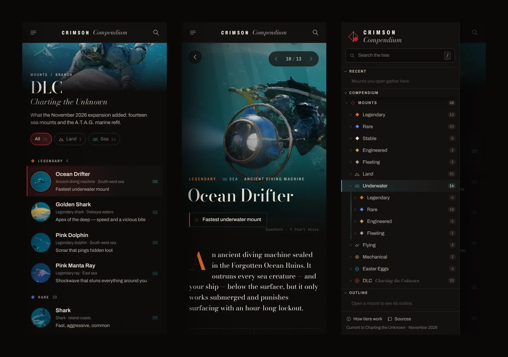<br><sub>Phone: list, plate, explorer drawer</sub></td>
  </tr>
  <tr>
    <td width="50%">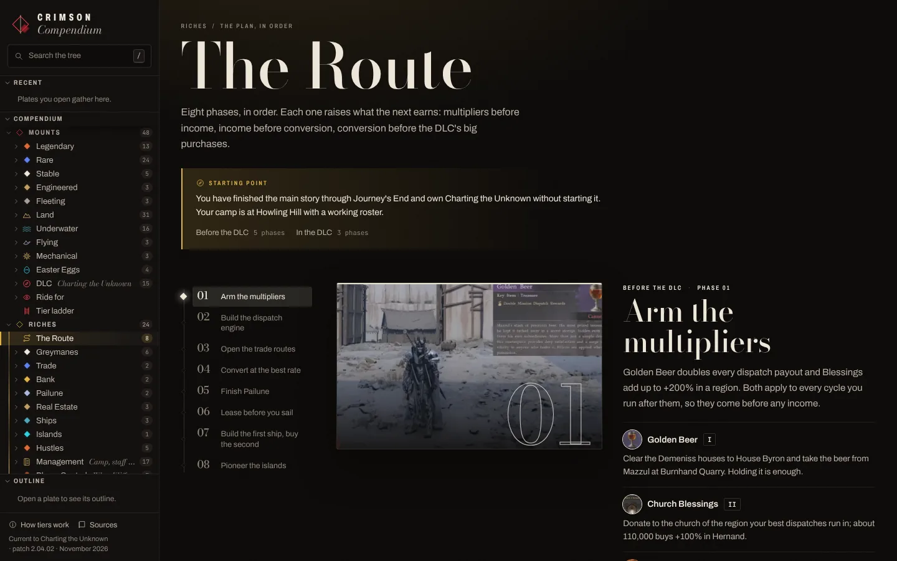<br><sub>Riches: The Route</sub></td>
    <td width="50%">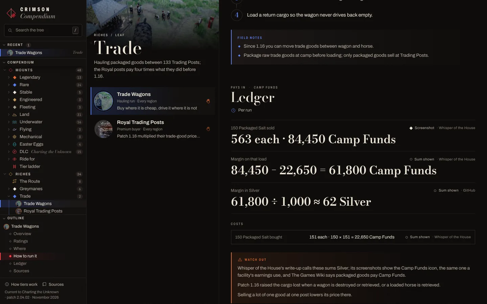<br><sub>Riches: a ledger, every figure with its basis</sub></td>
  </tr>
  <tr>
    <td width="50%">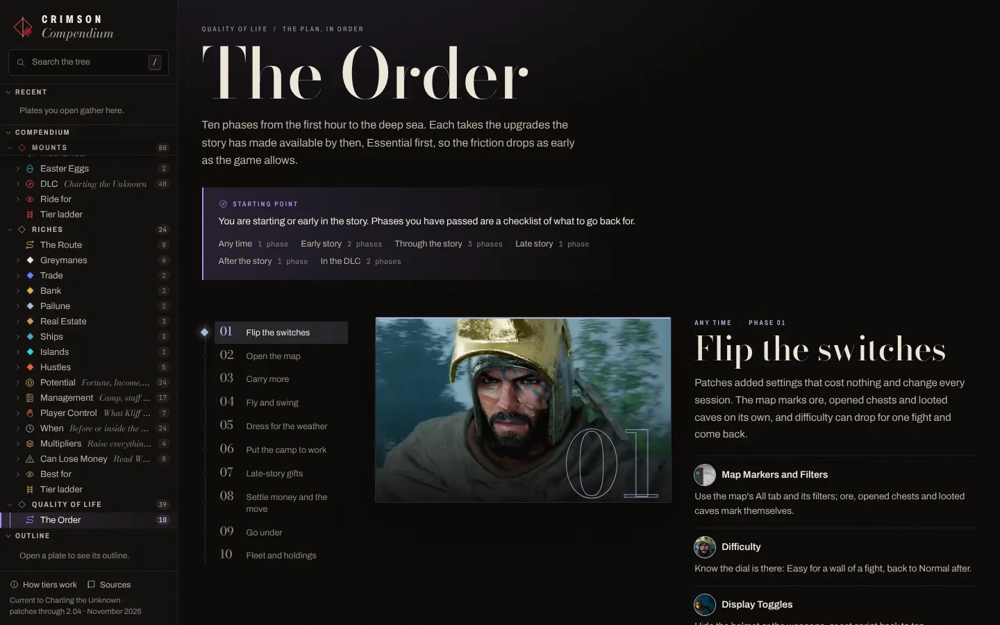<br><sub>Quality of Life: The Order</sub></td>
    <td width="50%">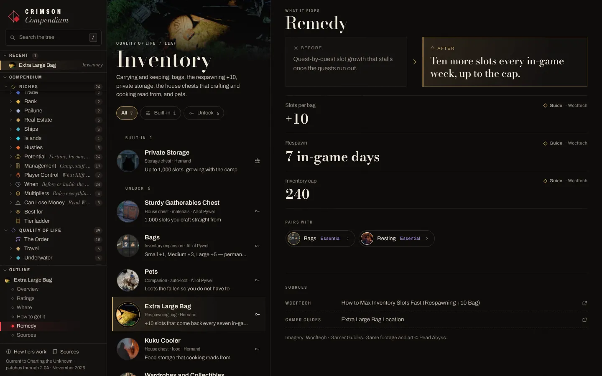<br><sub>Quality of Life: a Remedy, before and after</sub></td>
  </tr>
  <tr>
    <td width="50%">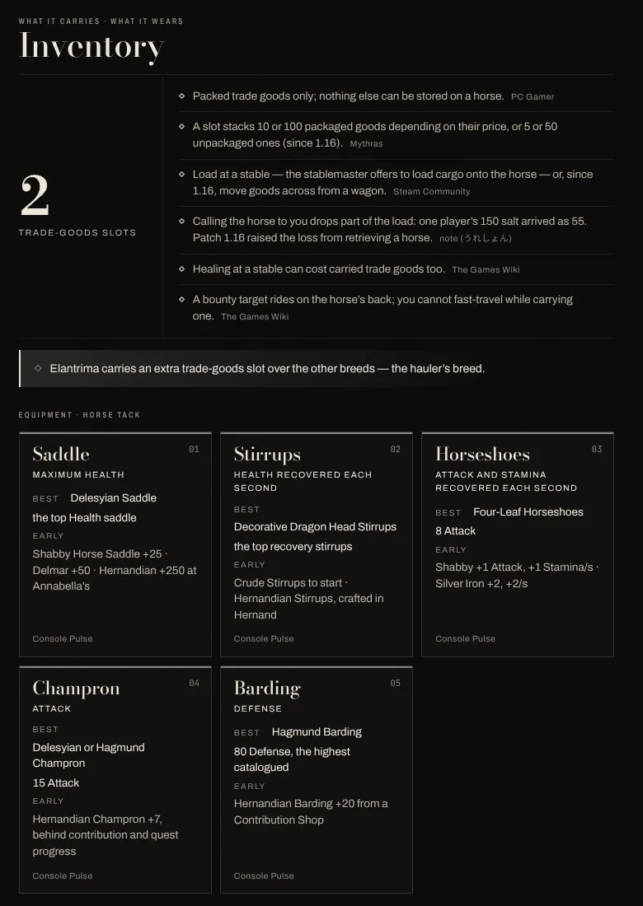<br><sub>Mounts: Inventory — trade-goods slots and the five tack slots</sub></td>
    <td width="50%">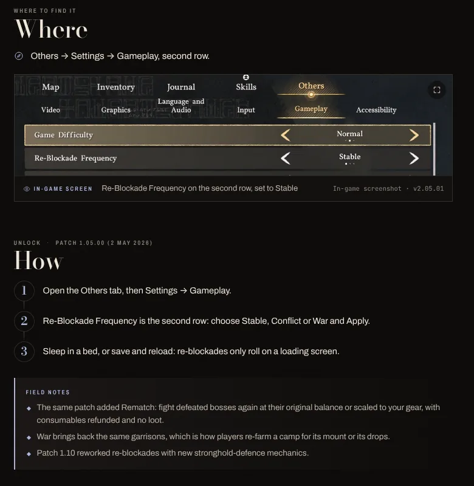<br><sub>Quality of Life: a settings plate on the 2.05.01 menu</sub></td>
  </tr>
  <tr>
    <td width="50%">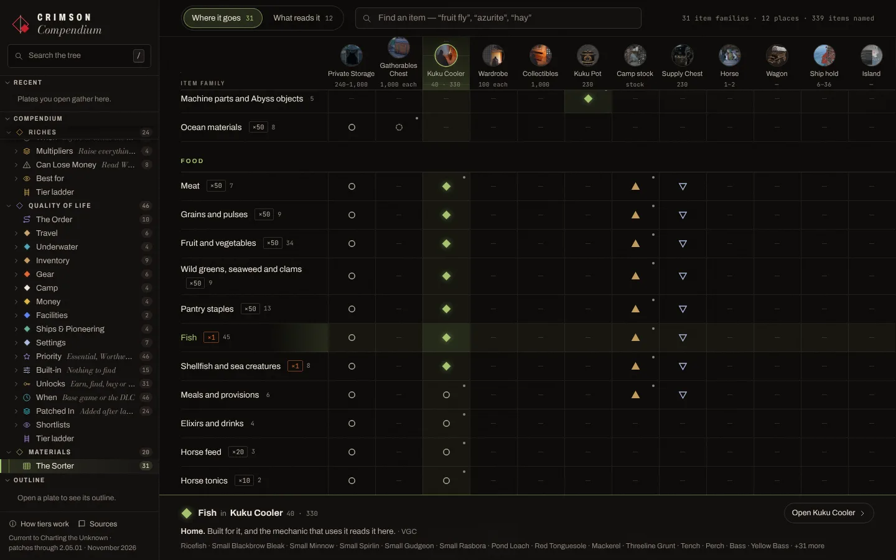<br><sub>Materials: the Sorter — every family against every place, the cell explained</sub></td>
    <td width="50%">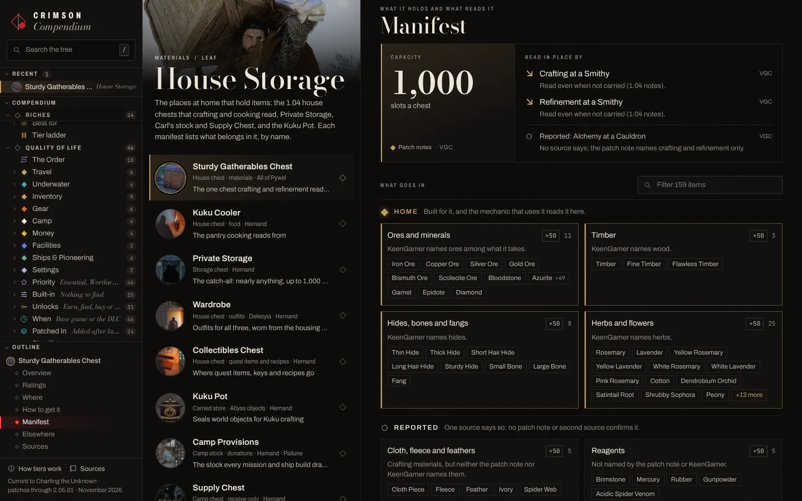<br><sub>Materials: a Manifest — capacity, what reads it, what goes in by name</sub></td>
  </tr>
  <tr>
    <td width="50%">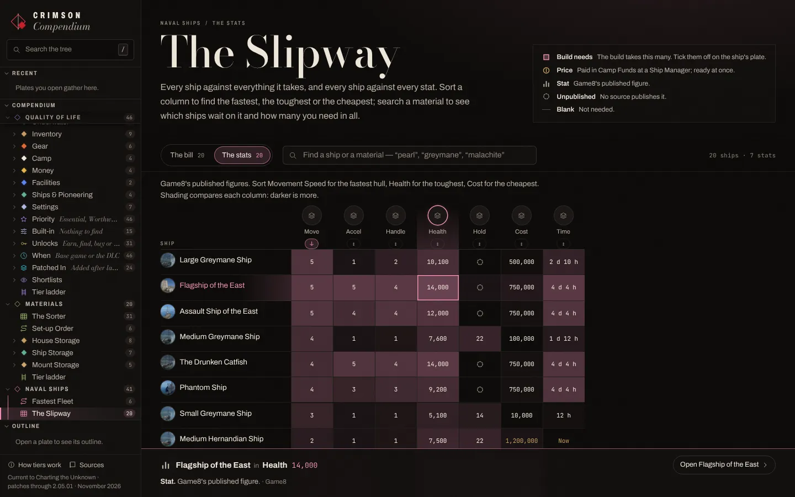<br><sub>Naval Ships: the Slipway — every ship's stats, sorted fastest first</sub></td>
    <td width="50%">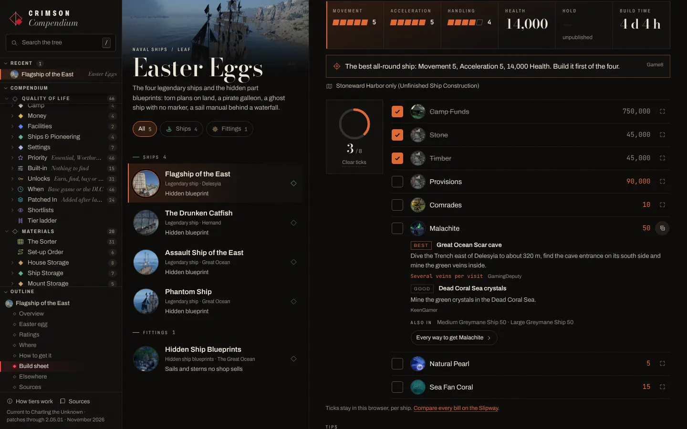<br><sub>Naval Ships: a build sheet — tick the bill, open a line for where to farm it</sub></td>
  </tr>
</table>

## Run it

**From a release.** Download `crimson-compendium-v*.zip` from [Releases](https://github.com/deadcoast/crimson-compendium/releases), unzip it and open `index.html`. It needs no server and no install; any static host serves the same folder.

**From source.** Node 18 or newer.

```sh
npm install
npm run dev      # http://localhost:5173
npm run build    # static site in dist/ — opens from disk or any host/sub-path
npm run check    # svelte-check type pass
npm run lint     # data lint: evidence, credits, captions, sources, image files
npm run verify   # build, then check every route, the explorer, phone, accessibility and offline fonts headless
                 # first time: npx playwright install chromium (or set CHROME_PATH to a Chrome binary)
npm run media    # fetch + convert images for entries with a new "from" URL (Python 3 + Pillow)
npm run pack     # dist-pack/: the build in at most 500 files, for hosts that cap a version's file count
```

## Keyboard

| Anywhere | |
| --- | --- |
| `/` or `Ctrl/⌘ K` | search mounts, money methods, upgrades, items, places, traits and branches |
| `J` / `K` or `→` / `←` | next / previous entry in the current list |
| `L` | Tier Ladder and back |
| `Alt \` or `Ctrl ⇧ E` | focus the explorer |

| In the explorer | |
| --- | --- |
| `↑` `↓` `PgUp` `PgDn` `Home` `End` | move |
| `→` / `←` | expand, or step into the folder · collapse, or step out to the parent |
| `Alt →` / `Alt ←` | expand / collapse a whole subtree |
| `Enter` · `Space` | open · fold |
| letters | jump to the next row starting with what you type |
| `Ctrl/⌘ F` · `Esc` | filter the tree · close the filter, then leave the tree |

The explorer follows the VS Code tree widget and Atom tree-view: focus is separate from selection, parent folders stay pinned at the top as you scroll, the active folder's guide line is drawn in its colour, and each mount row shows a hover card.

## Tiers

| | |
| --- | --- |
| **I** | Best in class — only the best of the best |
| **II** | Not as good as I, better than everything else |
| **III** | Average |
| **IV** | Below average |
| **V** | Not good |

Traits can lift a rating: no fall damage lifts Travel, a unique attack lifts Combat. Every rating stores the reasoning behind it. The full rules, and every editorial call made while building, are in [DESIGN.md](DESIGN.md).

## Project layout

```txt
src/
  core/              engine — knows nothing about mounts
    types.ts         TREE → BRANCH → (CATEGORY) → LEAF → ENTRY
    tree.ts          routes (#mounts-underwater-rare), lists, lenses, covers
    select.ts        selectors and tier ranking
    explorer.ts      explorer model: rows, filter, sticky rows, auto-reveal
    state.svelte.ts  route, overlays, recent history
  ui/                shared components (Explorer, LeafIndex, Plate, Ladder, Palette…)
  branches/
    registry.ts      lists the branches and validates them at load
    mounts/
      branch.json    leaves, category branches, metrics, classes, lenses, redirects
      entries.json   the 80 mounts
      kits.json      what each mount carries and wears, one profile per gear system
      MountRecord.svelte
      MountKit.svelte
    riches/
      branch.json    the same, plus labels, tier rules and the Route
      entries.json   the 24 money methods, each with its ledger
      RichesLedger.svelte
    qol/             the 46 upgrades, each with its remedy
    materials/
      branch.json    leaves, metrics, the Set-up Order; front: matrix
      matrix.json    the Sorter: item families and mechanics against every place
      entries.json   the 20 plates, each with its manifest
      MaterialsManifest.svelte
    naval/
      branch.json    leaves, metrics, lenses, the Fastest Fleet route
      matrix.json    the Slipway: every ship's bill and stats, values in the cells
      entries.json   the 41 plates: ships (built on their Mounts plates), materials, ventures
      NavalBuild.svelte    a ship's stats and its tickable bill
      NavalLedger.svelte   a material's or venture's ranked methods and totals
  styles/            tokens.css (every colour, font, easing) + base.css
public/media/        generated WebP files
tools/media.py       image pipeline (tools/sources holds in-game screenshots with no URL)
docs/
  PLAN.md            the global plan (IDENTIFIED → PLAN → SHELVED → TODO)
  RICHES-RESEARCH.md Riches research, every figure with its source
  MATERIALS-RESEARCH.md  Materials research: stores, readers, item families
  NAVAL-RESEARCH.md  Naval research: bills, material sources, conflicts
  spec/              treefold specs (tier-colors.txt)
  .archived/         original treefold prompts
  releases/          release notes, one per tag
  screenshots/       README images
history/             archived source and release zips
```

The built site is not committed: `npm run build` writes it to `dist/`, and each GitHub release attaches it as a zip.

## Extend it

**Add a mount.** Append to `src/branches/mounts/entries.json` (copy a neighbour), give each image a `from` URL and a `credit`, then run `npm run media`. The registry refuses to load on an id collision, an unknown leaf or class, a missing tier or an unbuilt portrait.

**Add a leaf.** Add to `leaves` in `branch.json` (`id`, `label`, `accent`, `blurb`, `short`, `cover`). The explorer, index, ladder filter, routes and every `"rarity"` category pick it up.

**Add a category branch.** Add to `categories` in `branch.json`:

```json
{ "id": "underwater", "label": "Underwater", "glyph": "sea", "accent": "sea",
  "blurb": "…", "where": { "domains": ["sea"] }, "leaves": "rarity",
  "cover": { "entry": "ocean-drifter", "role": "hero" } }
```

`where` takes `domains`, `tags` or `cls`. `"leaves": "rarity"` makes one leaf per rarity that has members; otherwise list your own leaves, each with its own `where`. Optional fields: `subtitle`, and `line: "egg"` to show each entry's `egg` note as its list line.

**Add a branch.** Create `src/branches/<id>/branch.json` and `entries.json` with the same schema, plus optional plate sections and an optional `matrix.json` (rows against columns, one mark per cell, or a value with `v` and `n` for sortable, shaded sheets; set `"front": "matrix"` to open the branch on it), then add one line to `registry.ts`. Nothing in `core/` or `ui/` changes.

## Sources and credits

Facts are cross-checked across Game8, Fextralife, GameRant, GamesRadar+, PowerUp Gaming, TheGamer, Vulkk and others. Where sources disagree, the entry follows the one with in-game evidence. Every plate lists its sources and credits its images to the guide that captured them. The app's **Sources** sheet lists them all.

*Crimson Desert*, its footage and its art are © Pearl Abyss. This is an unofficial fan reference, not affiliated with or endorsed by Pearl Abyss.

See [CHANGELOG.md](CHANGELOG.md) for release history.
