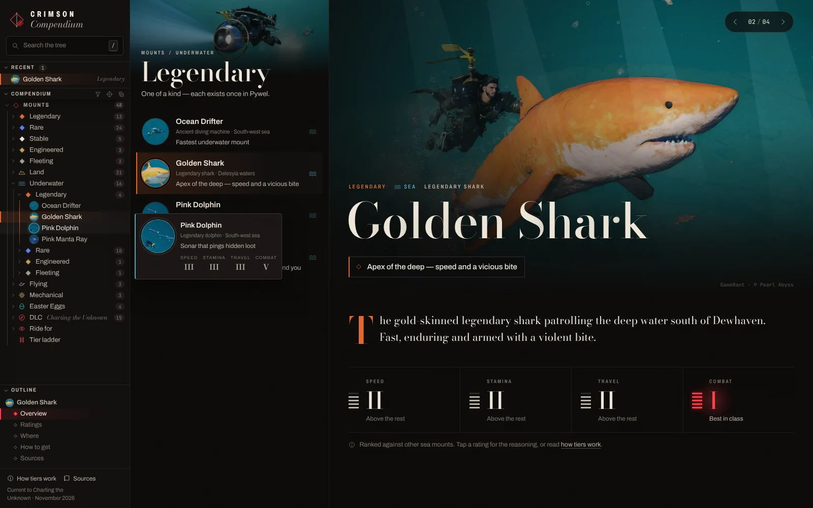

# v0.2.0 — Explorer & category branches

The Mounts branch gets an IDE-style explorer, six play-style category branches, a new mount, and a build that opens straight from disk.

## Highlights

- **Explorer.** An IDE-style tree, built on the VS Code tree widget and Atom tree-view, replaces the spine. It has three panes:
  - **Recent:** mounts you opened lately.
  - **Compendium:** the tree itself.
  - **Outline:** the open plate's sections, tracking where you are reading.

  `←` / `→` fold, letters jump to a name, `Ctrl/⌘ F` filters the tree, parent folders stay pinned at the top as you scroll, and each mount row shows a hover card with all four tiers. `Alt \` focuses the explorer from anywhere.
- **Category branches.** Land, Underwater, Flying, Mechanical, Easter Eggs and DLC: *Charting the Unknown*. Each splits into leaves, and a mount can appear in several.
- **New mount: Marni's Mechahorse,** the only mount that never spends stamina.
- **Easter egg notes** on plates: the Kuku Bird as Crimson Desert's Chocobo, Black Desert Online's Marni, the circus lion and the wildlife-park elephant.
- **Renames.** Long haul → **All Around Best** (ranked on all four ratings). Deep water and Flight became the **Underwater** and **Flying** branches; old links redirect.
- **Polish.** Tier seals fold 2×2 on narrow plates, plus gallery, credits and footer fixes, and explorer hardening from code review.

## Run it

Download **`crimson-compendium-v0.2.0.zip`** below, unzip it and open `index.html`. It needs no server and no install. To host it, upload the folder to any static host or sub-path.

From source: `npm install && npm run dev`. See the [README](https://github.com/deadcoast/crimson-compendium#readme).

Full list: [CHANGELOG.md](https://github.com/deadcoast/crimson-compendium/blob/main/CHANGELOG.md).

---
*Crimson Desert*, its footage and its art are © Pearl Abyss. This is an unofficial fan reference.
