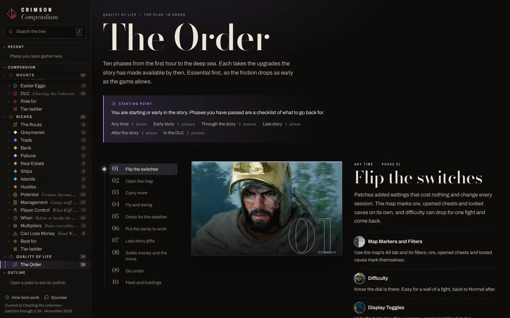
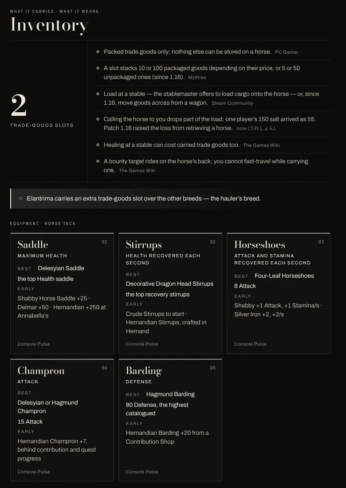

# v0.3.0 — Riches, Quality of Life and the full roster

Two new trees sit beside Mounts: **Riches**, an endgame money guide, and **Quality of Life**, a guide to every mechanic that takes the friction out of Pywel. The Mounts tree now holds all 80 mounts you can keep, and every plate says what the mount carries and what it wears. 150 plates in all.

## Highlights

- **Riches.** 24 money methods for a player past the main story, rated I–V on Return, Effort, Setup and Scale.
  - **The Route** takes them in eight phases.
  - **The Ledger** on every plate shows what it pays, each figure with its basis and publisher, and what to watch out for.
  - **Potential** sorts every method into Fortune, Income or Groundwork.
- **Quality of Life.** 46 upgrades in nine leaves, from Royler and the abyss nexus to the 2.05.01 settings menu, rated on Impact, Reach and Unlock.
  - **Priority** is worked out from those ratings: Essential, Worthwhile, Situational.
  - **The Order** runs ten phases from the first hour to the deep sea.
  - **The Remedy** on every plate gives before and after, the figures and the patch history.
  - Every patch through 2.05.01 was checked. Settings plates show the game's own Gameplay menu, with Re-Blockade Frequency's Stable, Conflict and War.
- **Every mount you can keep: 80, up from 48.**
  - The new plates include ships as a category of their own: the four legendary ships, the Greymane, Hernandian, Delesyian and Demenissian hulls in three sizes, and four rowboats.
  - 29 more world maps and 10 more banners.
  - Temporary rides are gone.
- **Inventory on every mount plate.**
  - *Carries*: trade-goods slots or hold, and the cargo rules. Elantrima and Rokade carry two slots; a loaded horse you call loses part of its load.
  - *Wears*: every equipment slot, with what it raises and the best piece. Horse tack, species saddles and their saddlers, Blackstar's armour, the A.T.A.G.'s parts and ship fittings with outfitter prices.
  - Feeding and healing for horses.
- **One how-to per mechanic.** A plate can borrow another branch's plate, so Royler's guide is written once for Mounts and QOL. *Elsewhere in the compendium* links each plate to the plates tied to it in other branches.
- **A gate behind every release.** `npm run verify` builds the site and checks it in a headless browser: the data lint, every plate, list and route, the explorer, the phone layout, accessibility (axe-core) and that the site needs nothing from the network.
- **Offline as designed.** Fonts ship with the site. Secondary text meets WCAG AA contrast, and the page has a proper `main` landmark for screen readers.

## Run it

Download **`crimson-compendium-v0.3.0.zip`** below, unzip it and open `index.html`. It needs no server and no install. To host it, upload the folder to any static host or sub-path.

From source: `npm install && npm run dev`. See the [README](https://github.com/deadcoast/crimson-compendium#readme).

Full list: [CHANGELOG.md](https://github.com/deadcoast/crimson-compendium/blob/main/CHANGELOG.md).

---
*Crimson Desert*, its footage and its art are © Pearl Abyss. This is an unofficial fan reference.
