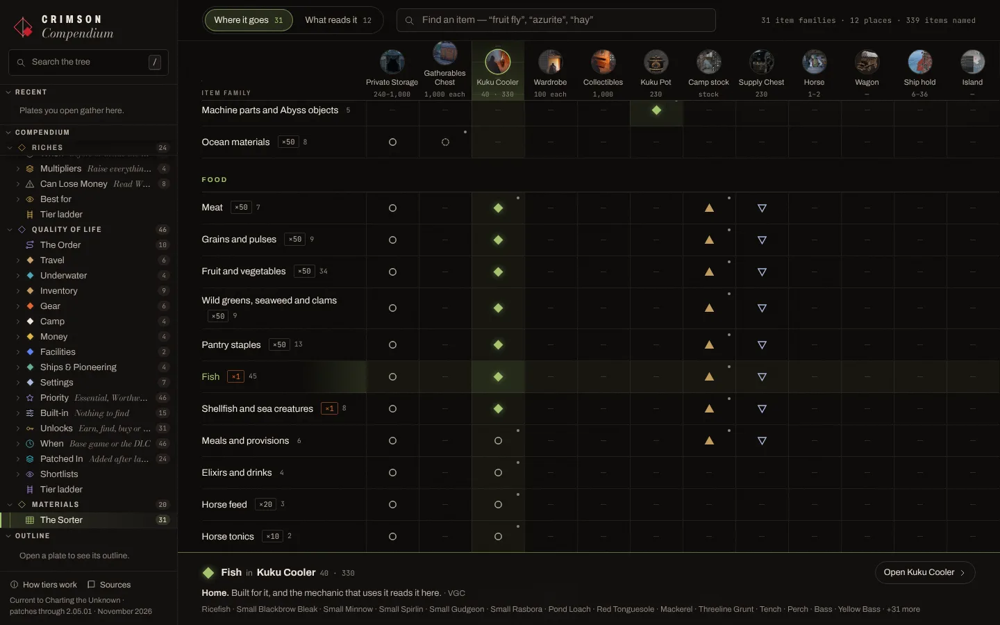
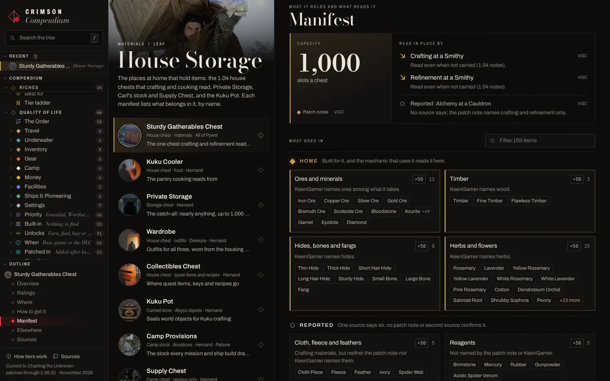

# v0.4.0 — Materials

A fourth tree joins Mounts, Riches and Quality of Life: **Materials** shows where every item goes and what reads it. The game has thirteen places that hold items, and each takes different things. The Smithy reads one house chest and cooking reads another. Camp missions and ship builds read only what you donated to Carl, and nothing reads Private Storage. The Sorter puts all of that in one grid.

## Highlights

- **The Sorter** opens the tree. It has two sheets:
  - *Where it goes*: 31 item families against the 12 places that hold items.
  - *What reads it*: 12 mechanics (crafting, cooking, alchemy, Kuku crafting, camp builds, trade, feeding, outfits, quests) against the same places and your bag.
  - Each cell carries one of seven marks, and each mark is a different shape: Home, Read here, Fits, Donate, Arrives, Reported, Refused.
  - Point at a cell, or arrow into the grid, and a readout says what the mark means, why, and which source says so.
  - Type an item, like "fruit fly" or "azurite", and one card tells you where it goes. The `/` search finds every item and family too.
  - On a phone the grid becomes one card per family.
- **20 plates in three branches:**
  - *House Storage*: the Gatherables Chest, Kuku Cooler, Private Storage, Wardrobe, Collectibles Chest, Kuku Pot, Camp Provisions and Supply Chest.
  - *Ship Storage*: ship holds, shipbuilding stock, both outfitters' parts, the four ship blueprints hidden at sea, ocean materials, the ship teleporter and Island Storage.
  - *Mount Storage*: horse trade slots, wagon cargo, horse feed, the Wells Military tack and Kuku mount gear.
- **A Manifest on every plate:**
  - how much the place holds, and what reads it in place;
  - what goes in, every item by name, with a filter;
  - what it refuses, and where everything else goes instead;
  - hold sizes for every ship and horse, read from the Mounts plates;
  - bills of materials for ship parts, sails and tack.
- **The Set-up Order:** six phases, in the order the story opens each store, with what to move in.
- Ratings: Capacity, Payoff and Unlock, I–V.

## Run it

Download **`crimson-compendium-v0.4.0.zip`** below, unzip it and open `index.html`. It needs no server and no install. To host it, upload the folder to any static host or sub-path.

From source: `npm install && npm run dev`. See the [README](https://github.com/deadcoast/crimson-compendium#readme).

Full list: [CHANGELOG.md](https://github.com/deadcoast/crimson-compendium/blob/main/CHANGELOG.md).

---
*Crimson Desert*, its footage and its art are © Pearl Abyss. This is an unofficial fan reference.
